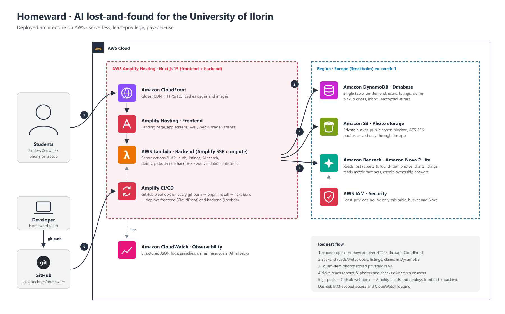

# Homeward

**Everything lost at UNILORIN finds its way home.**
An AI lost-and-found network for the University of Ilorin, built on AWS.

**Live:** https://main.djkawqlksis4l.amplifyapp.com &nbsp;·&nbsp; **Stack:** Next.js 15, TypeScript, Tailwind v4 · AWS Amplify, Lambda, DynamoDB, S3, Bedrock

---

## The problem

When students at UNILORIN misplace something, there is no reliable way for the person who finds it to get it back to them, so most lost items never make it home.

More than 50,000 students move every day between hostels, faculties, CBT centres, the library and shuttle parks on one of Nigeria's largest campuses. A Casio calculator is left on a CBT desk, a phone on a shuttle seat, an ID card beside the library photocopier. Most of it isn't stolen, just misplaced, and someone usually picks it up meaning to return it. The problem isn't honesty, it's connection. A WhatsApp status reaches a few hundred contacts out of 50,000 and disappears in a day.

## What Homeward does

| Step | What happens |
| --- | --- |
| **Snap it** | A finder takes one photo. AI drafts the listing (what it is, colour, brand, description) and suggests an ownership question. Guests can post without an account. |
| **Say it** | An owner describes the loss in plain words, pidgin included: *"my black HP laptop don loss for main library last night"*. AI extracts what, where and when, and ranks every find on campus by match score. |
| **Prove it** | The owner answers a question only they could know, set by the finder. The check allows for different wording but not guesses. Three wrong answers lock the claim. |
| **Collect it** | Proof unlocks the finder's contact and a **one-time pickup code**. They meet somewhere public on campus; the finder enters the owner's code before handing over. A matching code marks the item returned and earns the finder **+50 karma**. |

**ID cards are never listed.** They're matched privately by matric number (read from the card's photo), and only the student on the card can see it.

## Architecture



| AWS service | Role in Homeward |
| --- | --- |
| **AWS Amplify Hosting** | Builds and hosts the app; CI/CD on every push to `main` (`amplify.yml`) |
| **AWS Lambda** (Amplify SSR compute) | The backend: server actions and API routes for auth, listings, AI search, claims and handover |
| **Amazon CloudFront** | HTTPS and edge caching for pages and AVIF/WebP images |
| **Amazon DynamoDB** | Single-table database: users, listings, claims, pickup codes, inbox |
| **Amazon S3** | Private, encrypted photo bucket; photos are streamed only through the app |
| **Amazon Bedrock** (Amazon Nova 2 Lite) | Parses lost reports, reads photos, drafts listings, reads matric numbers, judges ownership answers |
| **AWS IAM** | Least-privilege policy: this table, this bucket, Amazon Nova, nothing else |
| **Amazon CloudWatch** | Structured JSON logs for searches, claims, handovers and AI fallbacks |

**Deployment.** One push deploys everything. Amplify builds the Next.js app, serves the frontend through CloudFront and runs the backend on Lambda. Data lives in `eu-north-1` (Stockholm), provisioned by `pnpm aws:setup`. Step-by-step setup: [docs/AWS-SETUP.md](docs/AWS-SETUP.md).

**Resilience.** Every AI call has a deterministic fallback: a keyword parser for reports, word-overlap for answers, and colour read in the browser for photos. A slow or unavailable model never breaks a search.

## Security

- **Proof before contact:** finder details are revealed only after ownership is proved; handover needs the owner's one-time code.
- **Private photos:** S3 has public access fully blocked and AES-256 encryption. ID-card photos are served only to the finder and the card's owner.
- **Accounts:** bcrypt password hashes; HS256-signed, httpOnly, SameSite cookies; same-site redirects only.
- **Inputs:** every action is validated with zod and rate-limited (sign-in, posting, photo analysis, search, claims, handover).
- **AI hardening:** model output is grounded (a field is kept only if the model can quote the words that justify it), and claimant text is treated as untrusted in the answer judge.

## Code tour

Feature-first, with business rules kept free of frameworks and AWS (ports and adapters).

```
src/
  app/                  routes only: (marketing) landing, (auth) sign-in/up, (app) home, found, lost, items
  features/
    auth/               sign-up, sign-in, session actions and forms
    found/              snap-to-list wizard, photo resize, on-device colour reading
    lost/               natural-language search
    claims/             ownership check, pickup code, handover
    items/              listing cards and grid
    landing/, ai-demo/  marketing site and the animated AI demo
  core/
    domain/             pure rules: matching, answer checking, pickup codes, privacy
    ports/              interfaces for repositories, AI, storage
  infra/
    aws/                DynamoDB, S3, Bedrock adapters
    mock/               in-memory adapters for local development
    container.ts        the one composition root (HOMEWARD_ADAPTERS=mock | aws)
  lib/                  env (zod), sessions, errors, logging, rate limiting
  ui/                   design-system primitives
```

**Matching** blends explainable field scores (category .45, brand .2, colour .15, place .2 with campus-zone proximity) with semantic similarity when embeddings are available. See [`core/domain/matching.ts`](src/core/domain/matching.ts).

## Run it locally

```bash
pnpm install
pnpm dev          # http://localhost:3000, in-memory adapters, no AWS needed
pnpm test         # unit tests (Vitest)
pnpm typecheck
pnpm lint
```

Node 22+ and pnpm 10. To run against real AWS, follow [docs/AWS-SETUP.md](docs/AWS-SETUP.md), then `pnpm aws:setup`.

| Variable | Purpose |
| --- | --- |
| `HOMEWARD_ADAPTERS` | `mock` (default) or `aws` |
| `HOMEWARD_REGION` | AWS region, default `eu-north-1` |
| `HOMEWARD_TABLE` / `HOMEWARD_BUCKET` | DynamoDB table and S3 bucket (written by `aws:setup`) |
| `HOMEWARD_SESSION_SECRET` | 32+ characters, signs session cookies |
| `HOMEWARD_TEXT_MODEL` | Bedrock model, default `eu.amazon.nova-2-lite-v1:0` |

## Design and performance

- **Images:** `scripts/build-images.mjs` turns source art into AVIF and WebP at 640–2400px with blur placeholders, served through `next/image`.
- **Motion:** Motion and Lenis on the landing page. The hero entrance is pure CSS so it paints before hydration, and everything respects `prefers-reduced-motion`.
- **Accessibility:** labelled form controls, live regions for AI results, AA contrast and 44px tap targets.
- **Icons:** Lucide.
